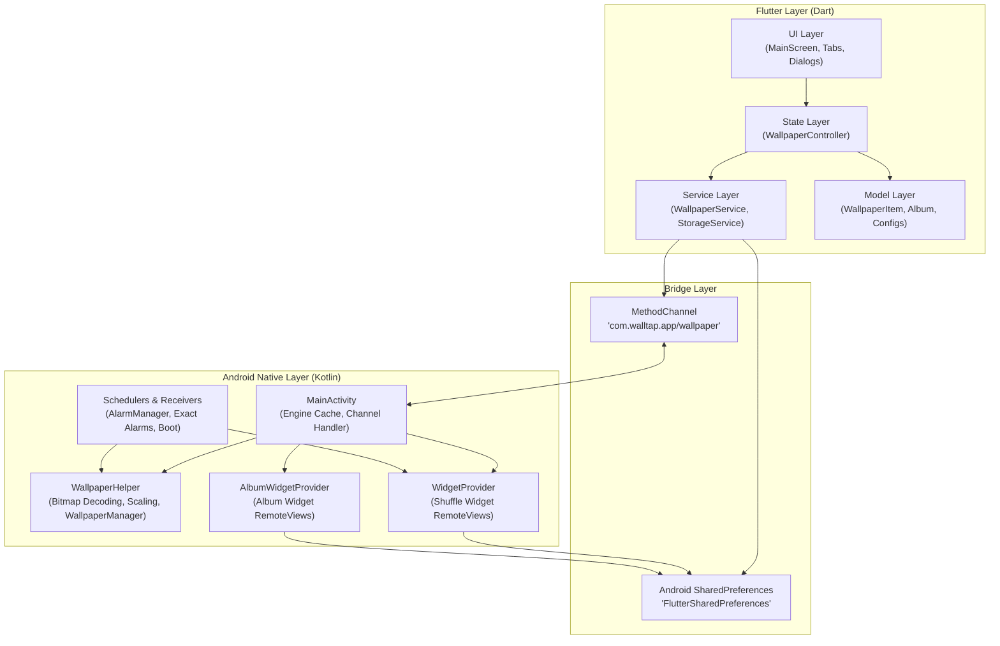
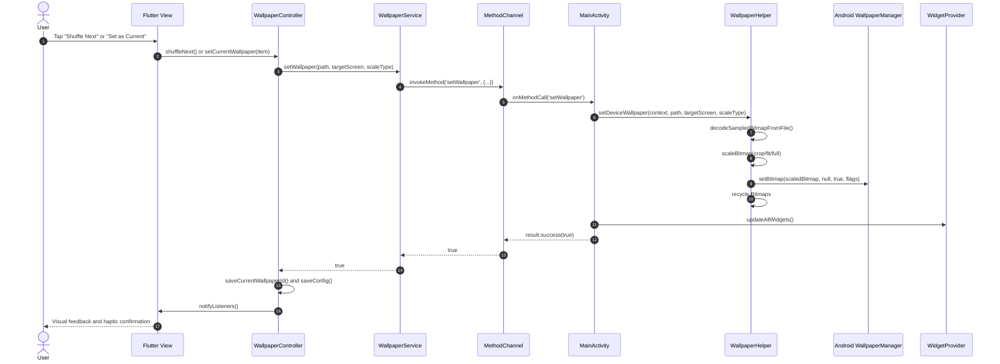

# 01 - System Architecture & Bridge

Technical architecture, component layers, platform channel contracts, and data synchronization between Flutter and Android native code in Wall Tap.

---

## 1. System Architecture

Wall Tap separates concerns between the Flutter cross-platform presentation layer and the Android native execution engine.

---

## 2. Flutter Layer Structure

### 2.1 Model, View, Controller & Services
- **Models (`lib/models/`)**: Immutable data models (`WallpaperItem`, `Album`, `SlideshowConfig`, `AlbumWidgetConfig`). Models serialize via `toMap()`/`fromMap()` and `toJson()`/`fromJson()`, and support non-destructive mutation via `copyWith()`.
- **Views (`lib/views/`)**: Render application screens and observe controller updates:
  - `MainScreen`: Hosts the floating navigation bar, tracks active tab index (`Studio`, `Library`, `Widgets`, `Settings`), and handles app lifecycle events.
  - `slideshow/slideshow_tab.dart`: Studio tab for manual wallpaper shuffle, timer intervals, target screen settings, and image scale modes.
  - `playlist/playlist_tab.dart`: Library tab managing all wallpapers, multi-selection batch actions, and custom albums.
  - `playlist/album_detail_screen.dart`: Album detail view for managing wallpapers in a specific collection.
  - `album_widgets/album_widgets_tab.dart`: Widget management tab for monitoring placed home screen widgets.
  - `settings/settings_tab.dart`: Battery optimization status and application information.
  - `widgets/`: Reusable components including `PressableScale`, `WallpaperPreviewDialog`, and `WidgetGuideDialog`.
- **Controller (`lib/controllers/wallpaper_controller.dart`)**: Extends `ChangeNotifier` as the single source of truth for UI state. Manages active items, album filtering, image imports, deletion cascades, and settings updates.
- **Services (`lib/services/`)**:
  - `StorageService`: Manages local image storage in `app_flutter/wallpapers/`, pixel dimension parsing via `dart:ui`, and key-value persistence in `SharedPreferences`.
  - `WallpaperService`: Encapsulates `MethodChannel` invocations to native Kotlin handlers.

---

## 3. Android Native Architecture

### 3.1 Kotlin Engine Components
The Android layer handles operations that must run natively in the background:
1. **Wallpaper Application**: Interacts directly with `android.app.WallpaperManager` to apply bitmaps to `FLAG_SYSTEM` (Home screen), `FLAG_LOCK` (Lock screen), or both.
2. **Sampled Bitmap Decoding**: Uses `BitmapFactory.Options.inSampleSize` to scale high-resolution images to device display dimensions before applying transformations (`crop`, `fit`, `full`), preventing memory overflow.
3. **AppWidgets**: Implements `WidgetProvider` and `AlbumWidgetProvider` to render interactive home screen widgets using `RemoteViews` without launching the Flutter engine.
4. **Alarm Scheduling**: Uses `AlarmManager.setExactAndAllowWhileIdle()` to run wallpaper rotations on exact intervals, including during Android Doze mode.

---

## 4. Platform Channel Contract

Flutter and Kotlin communicate through a dedicated `MethodChannel`:
- **Channel Name**: `com.walltap.app/wallpaper`

### 4.1 Method Specifications

| Method Name | Arguments | Return Type | Description |
| :--- | :--- | :--- | :--- |
| `setWallpaper` | `filePath` (String), `targetScreen` (String: `'both'`, `'home'`, `'lock'`), `scaleType` (String: `'full'`, `'crop'`, `'fit'`) | `Boolean` | Decodes image, scales it, applies to target screens, and refreshes launcher widgets. |
| `updateWidget` | None | `Boolean` | Refreshes all active `WidgetProvider` launcher widgets with current playlist data. |
| `getDisplayDimensions` | None | `Map<String, Int>` (`width`, `height`) | Returns physical display dimensions in pixels. |
| `updateSchedule` | `intervalMinutes` (Int) | `Boolean` | Schedules or cancels `AlarmManager` wakeup alarms for wallpaper rotation. |
| `isBatteryOptimizationIgnored` | None | `Boolean` | Checks whether Wall Tap is exempted from battery optimizations. |
| `requestIgnoreBatteryOptimizations` | None | `Boolean` | Prompts user to grant battery optimization exemption (`ACTION_REQUEST_IGNORE_BATTERY_OPTIMIZATIONS`). |
| `pickFolderAndGetImages` | None | `List<String>` | Opens Android Storage Access Framework folder picker and returns list of cached image paths. |
| `getAlbumWidgets` | None | `List<Map<String, Any>>` | Returns configuration metadata for all active `AlbumWidgetProvider` instances on the launcher. |
| `updateAlbumWidget` | `widgetId` (Int), `albumId` (String), `albumName` (String), `intervalMinutes` (Int), `isRandom` (Boolean) | `Boolean` | Saves widget configuration to SharedPreferences, schedules its timer, and refreshes display. |
| `shuffleAlbumWidget` | `widgetId` (Int) | `Boolean` | Manually advances the specified album widget to its next photo. |
| `updateAllAlbumWidgets` | None | `Boolean` | Re-renders all album widgets placed on the home screen. |

---

## 5. Sequence Flows

### 5.1 Manual Wallpaper Shuffle Flow

### 5.2 Scheduled Background Rotation Flow

---

## 6. Shared State Synchronization

Android widgets and background alarms run independently of the Flutter process. State synchronization occurs via `SharedPreferences`:
- Kotlin reads and writes to XML preferences file `"FlutterSharedPreferences"` using keys prefixed with `"flutter."` (e.g. `flutter.walltap_current_index`).
- When the user returns to the app, `MainScreen`'s `WidgetsBindingObserver` detects `AppLifecycleState.resumed` and calls `controller.reloadFromStorage()`, updating the Flutter UI to reflect any changes made by background routines.
