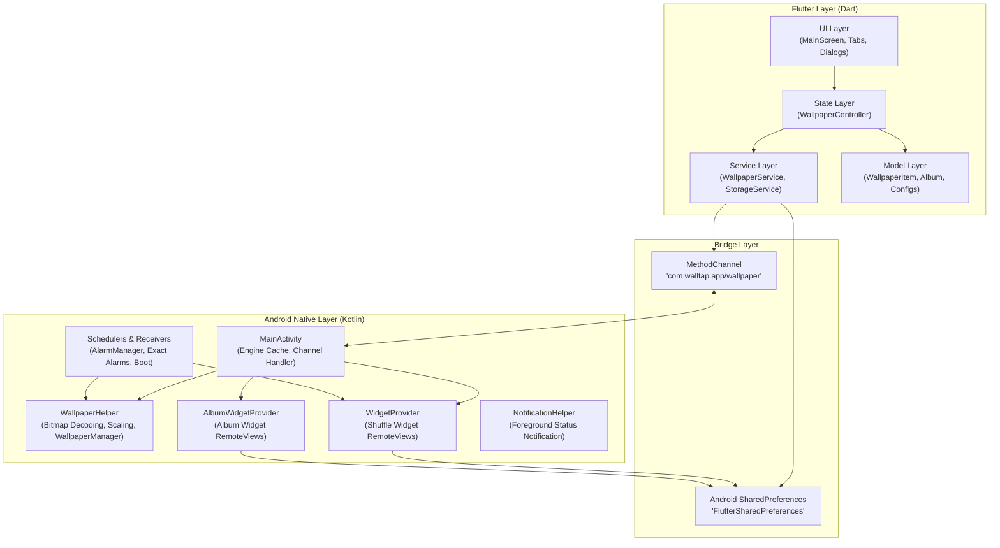
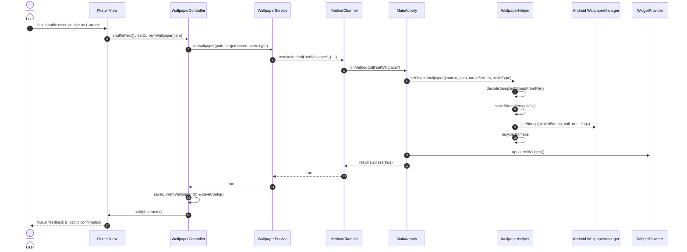
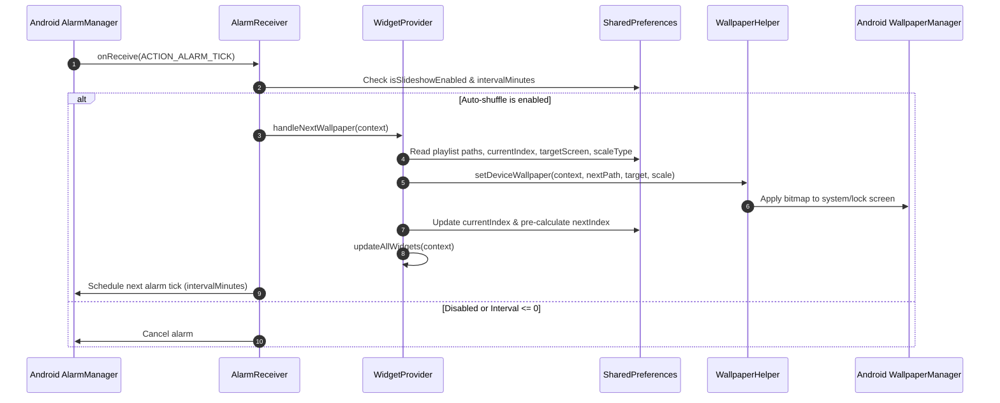

# 01 - System Architecture & Bridge

Wall Tap is a high-performance wallpaper manager and home screen widget application for Android built with Flutter and Kotlin. This document outlines the high-level system architecture, component layers, inter-process communication (IPC) via `MethodChannel`, and data flow sequences.

---

## 1. High-Level Architecture

Wall Tap adopts a decoupled, multi-tier architecture that splits responsibilities cleanly between the Flutter cross-platform presentation and state layer, and the Android native execution engine.

---

## 2. Flutter Architecture

### 2.1 Model-View-Controller / Service Pattern
- **Models (`lib/models/`)**: Immutable data carriers (`WallpaperItem`, `Album`, `SlideshowConfig`, `AlbumWidgetConfig`). Models support serialization via `toMap()`/`fromMap()` and `toJson()`/`fromJson()`, along with immutable updating through `copyWith()`.
- **Views (`lib/views/`)**: Render the user interface and bind to state:
  - `MainScreen`: Hosts the persistent glassmorphic bottom navigation bar, manages active tab index (`Studio`, `Gallery`, `Widgets`, `Settings`), and listens to app lifecycle events.
  - `slideshow/slideshow_tab.dart`: Studio tab for quick shuffles, auto-interval setup, target screen configuration, and scale type adjustments.
  - `playlist/playlist_tab.dart`: Gallery tab hosting all wallpapers, batch multi-selection mode, and custom albums.
  - `playlist/album_detail_screen.dart`: Dedicated album screen for managing wallpapers within a specific collection.
  - `album_widgets/album_widgets_tab.dart`: Widget management tab for monitoring and configuring placed Android home screen widgets.
  - `settings/settings_tab.dart`: System settings, persistent notifications, battery optimization status, and storage breakdowns.
  - `widgets/`: Reusable components such as `PressableScale`, `WallpaperPreviewDialog`, and `WidgetGuideDialog`.
- **Controller (`lib/controllers/wallpaper_controller.dart`)**: Single source of truth extending `ChangeNotifier`. Manages collection state, active album filtering, image imports, deletion cascades, and settings updates.
- **Services (`lib/services/`)**:
  - `StorageService`: Manages local file saving in `app_flutter/wallpapers/`, image dimension parsing via `dart:ui`, and key-value persistence in `SharedPreferences`.
  - `WallpaperService`: Encapsulates all `MethodChannel` invocations to native Kotlin.

---

## 3. Native Android Architecture

### 3.1 Kotlin Engine Responsibilities
The native Android layer handles platform operations that cannot be performed reliably by Flutter in the background:
1. **Direct System Wallpaper Manipulation**: Uses `android.app.WallpaperManager` to apply bitmaps to `FLAG_SYSTEM` (Home screen), `FLAG_LOCK` (Lock screen), or both.
2. **Memory-Safe Bitmap Decoding & Scaling**: Custom sampling (`inSampleSize`) downsamples high-resolution images to match device screen bounds before applying transformations (`crop`, `fit`, `full`).
3. **Home Screen AppWidgets**: Supports interactive widgets (`WidgetProvider` and `AlbumWidgetProvider`) that update directly from background alarms or user clicks on the home screen without launching the Flutter engine.
4. **Reliable Alarm Scheduling**: Utilizes `AlarmManager.setExactAndAllowWhileIdle()` via `Scheduler` and `AlbumWidgetScheduler` to execute wallpaper rotations even in low-power idle states (Doze mode).
5. **Foreground Service Notification**: Provides an ongoing, low-priority status notification (`NotificationHelper`) to prevent the operating system from terminating background rotation processes.

---

## 4. MethodChannel Contract

Communication between Flutter and Kotlin occurs over the platform channel:
- **Channel Name**: `com.walltap.app/wallpaper`

### 4.1 Method API Specification

| Method Name | Arguments | Return Type | Description |
| :--- | :--- | :--- | :--- |
| `setWallpaper` | `filePath` (String), `targetScreen` (String: `'both'`, `'home'`, `'lock'`), `scaleType` (String: `'full'`, `'crop'`, `'fit'`) | `Boolean` | Decodes image, scales it, applies to specified screen(s), and updates home screen widgets. |
| `updateWidget` | *None* | `Boolean` | Refreshes all active `WidgetProvider` home screen widgets with current playlist data. |
| `getDisplayDimensions` | *None* | `Map<String, Int>` (`width`, `height`) | Returns actual screen resolution in physical pixels for aspect ratio calculations. |
| `updateSchedule` | `intervalMinutes` (Int) | `Boolean` | Sets or cancels `AlarmManager` repeating alarm for automatic wallpaper rotation. |
| `isBatteryOptimizationIgnored`| *None* | `Boolean` | Checks if Wall Tap is whitelisted from Android battery optimizations. |
| `requestIgnoreBatteryOptimizations` | *None* | `Boolean` | Prompts user to grant battery optimization exemption (`ACTION_REQUEST_IGNORE_BATTERY_OPTIMIZATIONS`). |
| `pickFolderAndGetImages` | *None* | `List<String>` | Opens Android Storage Access Framework (SAF) folder picker and returns list of cached image paths. |
| `getAlbumWidgets` | *None* | `List<Map<String, Any>>` | Returns configuration and status metadata for all active `AlbumWidgetProvider` instances on the home screen. |
| `updateAlbumWidget` | `widgetId` (Int), `albumId` (String), `albumName` (String), `intervalMinutes` (Int), `isRandom` (Boolean) | `Boolean` | Saves widget configuration to SharedPreferences, schedules its timer, and refreshes the widget. |
| `shuffleAlbumWidget` | `widgetId` (Int) | `Boolean` | Manually advances the specified album widget to its next image. |
| `updateAllAlbumWidgets` | *None* | `Boolean` | Re-renders all album widgets placed on the home screen. |
| `showPersistentNotification` | *None* | `Boolean` | Creates notification channel and posts persistent foreground status notification. |
| `hidePersistentNotification` | *None* | `Boolean` | Cancels the persistent foreground status notification. |
| `isPersistentNotificationEnabled` | *None* | `Boolean` | Queries whether the persistent notification is enabled in preferences. |

---

## 5. Sequence Diagrams

### 5.1 Manual Wallpaper Shuffle / Set Flow

### 5.2 Background Scheduled Rotation Flow

---

## 6. Shared State & Inter-Process Synchronization

Because Android widgets and background alarms execute in independent Android processes or broadcast contexts without an active Flutter runtime, state is synchronized via `SharedPreferences`:
- Native Kotlin reads and writes to SharedPreferences using filename `"FlutterSharedPreferences"` and keys prefixed with `"flutter."` (e.g., `flutter.walltap_current_index`).
- When the user returns to the Flutter application, `MainScreen`'s `WidgetsBindingObserver` detects `AppLifecycleState.resumed` and triggers `controller.reloadFromStorage()`. This ensures any wallpaper shifts or widget changes performed outside the app are reflected in the UI immediately.
