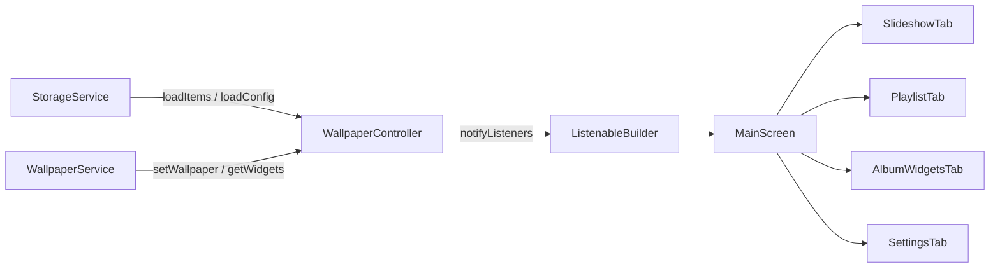

# 03 - State Management, Storage & Persistence

This document details Wall Tap's state management patterns, local persistence architecture, file system storage structure, and the critical shared preferences contract between Flutter and native Android.

---

## 1. State Management Architecture

Wall Tap utilizes the standard Flutter **`ChangeNotifier`** pattern via **`WallpaperController`**.



### 1.1 Dependency Injection & Testability
`WallpaperController` accepts optional service implementations through its constructor:

```dart
WallpaperController({
  StorageService? storageService,
  WallpaperService? wallpaperService,
})  : _storageService = storageService ?? StorageService(),
      _wallpaperService = wallpaperService ?? WallpaperService();
```

This design allows unit tests to inject fakes (`FakeStorageService`, `FakeWallpaperService`) without invoking real platform channels or disk I/O.

### 1.2 Encapsulation & Immutable Excursions
Internal mutable lists are never exposed directly. The controller exposes unmodifiable list views to prevent unintended state mutations from UI widgets:

```dart
List<WallpaperItem> get items => List.unmodifiable(_items);
List<Album> get albums => List.unmodifiable(_albums);
List<AlbumWidgetConfig> get albumWidgets => List.unmodifiable(_albumWidgets);
```

### 1.3 Active Items & Album Filtering
The `activeItems` getter calculates the working rotation set dynamically:
1. If an album is selected (`activeAlbumId != null`), only wallpapers whose IDs exist in the album's `wallpaperIds` **and** have `isEnabled == true` are returned.
2. If no album is selected, all items in the library with `isEnabled == true` are returned.

---

## 2. App Lifecycle & Inter-Process State Sync

Because Android AppWidgets and background alarms modify rotation indexes outside Flutter's runtime, the app implements lifecycle observer synchronization:

```dart
class _MainScreenState extends State<MainScreen> with WidgetsBindingObserver {
  @override
  void initState() {
    super.initState();
    WidgetsBinding.instance.addObserver(this);
  }

  @override
  void didChangeAppLifecycleState(AppLifecycleState state) {
    if (state == AppLifecycleState.resumed) {
      widget.controller.reloadFromStorage();
    }
  }
}
```

When `reloadFromStorage()` executes:
1. Re-reads config and indices from `SharedPreferences`.
2. Compares active index, rotation interval, target screen, and battery optimization state against memory.
3. If native processes advanced the wallpaper or modified settings, the controller updates its fields and calls `notifyListeners()`, immediately updating the UI.

---

## 3. SharedPreferences Key Registry

Native Android (`Context.getSharedPreferences("FlutterSharedPreferences", MODE_PRIVATE)`) and Flutter (`package:shared_preferences`) share the same XML backing file. In Flutter's shared preferences plugin on Android, all keys are stored with a `"flutter."` prefix.

> [!CAUTION]
> **AI Agents and Developers**: Never rename or delete any key below without updating **both** Dart (`StorageService.dart`) and Kotlin (`MainActivity.kt`, `WidgetProvider.kt`, `AlbumWidgetProvider.kt`, `AlarmReceiver.kt`).

| Key Name | Dart Key Constant | Type | Read/Written By | Purpose |
| :--- | :--- | :--- | :--- | :--- |
| `flutter.walltap_items` | `_keyItems` | String (JSON) | Dart | Serialized list of all `WallpaperItem` records. |
| `flutter.walltap_config` | `_keyConfig` | String (JSON) | Dart & Kotlin | Serialized `SlideshowConfig` containing app rotation settings. |
| `flutter.walltap_playlist_paths` | `_keyPaths` | String (JSON) | Dart & Kotlin | Raw JSON array of file paths for currently active rotation items. Used by Kotlin `WidgetProvider` without parsing full model objects. |
| `flutter.walltap_current_index` | `_keyCurrentIndex` | Long / Int | Dart & Kotlin | Zero-based index of the currently set wallpaper in the active playlist. |
| `flutter.walltap_next_index` | `_keyNextIndex` | Long / Int | Dart & Kotlin | Pre-calculated index of the next wallpaper to be displayed on the widget thumbnail or next rotation. |
| `flutter.walltap_target_screen` | `_keyTargetScreen` | String | Dart & Kotlin | Screen target (`"both"`, `"home"`, or `"lock"`). |
| `flutter.walltap_scale_type` | `_keyScaleType` | String | Dart & Kotlin | Bitmap scaling mode (`"full"`, `"crop"`, or `"fit"`). |
| `flutter.walltap_is_random` | `_keyIsRandom` | Boolean | Dart & Kotlin | Whether rotation order is randomized. |
| `flutter.walltap_slideshow_enabled`| `_keySlideshowEnabled` | Boolean | Dart & Kotlin | Master toggle for automatic rotation timer. |
| `flutter.walltap_interval_minutes` | `_keyIntervalMinutes` | Long / Int | Dart & Kotlin | Interval in minutes between rotations (0 = manual). |
| `flutter.walltap_albums` | `_keyAlbums` | String (JSON) | Dart & Kotlin | Serialized list of `Album` objects. Read by native `AlbumWidgetProvider` and `AlbumWidgetConfigureActivity`. |
| `flutter.walltap_active_album_id` | `_keyActiveAlbumId` | String | Dart | ID of album currently powering the Studio rotation (or null for all). |
| `flutter.walltap_current_wallpaper_id` | `_keyCurrentWallpaperId` | String | Dart | ID of currently active device wallpaper (used for rendering `CURRENT` badge). |
| `flutter.album_widget_${id}_album_id` | N/A | String | Dart & Kotlin | Target album ID for home screen widget instance `${id}`. |
| `flutter.album_widget_${id}_album_name` | N/A | String | Dart & Kotlin | Display name of album for home screen widget `${id}`. |
| `flutter.album_widget_${id}_interval_minutes` | N/A | Long / Int | Dart & Kotlin | Auto-advance cadence for home screen widget `${id}`. |
| `flutter.album_widget_${id}_is_random` | N/A | Boolean | Dart & Kotlin | Random vs sequential order for home screen widget `${id}`. |
| `flutter.album_widget_${id}_current_index` | N/A | Long / Int | Dart & Kotlin | Current photo index displayed in home screen widget `${id}`. |
| `flutter.album_widget_${id}_show_controls` | N/A | Boolean | Kotlin | Controls whether next/settings buttons are visible on the widget. |

---

## 4. Local File Storage Architecture

Wallpapers imported into Wall Tap are copied into the application's private internal storage to guarantee availability and prevent broken links if the user deletes the original photo from external storage.

### 4.1 Directory Location
```
<app_internal_storage>/app_flutter/wallpapers/
```
Accessed via `path_provider.getApplicationDocumentsDirectory()`.

### 4.2 File Naming Convention
Files are named using the pattern:
```
wall_${timestamp}_${sanitizedFileName}.${extension}
```
Example: `wall_1716301294821_cyberpunk_neon_city.jpg`

Characters other than alphanumeric, underscore, and dot are replaced with `_` to guarantee cross-filesystem compatibility.

### 4.3 Dimension Extraction
When an image is imported, `StorageService.getImageDimensions` extracts pixel dimensions without decoding full uncompressed pixel arrays into memory using Flutter's low-level codec engine:

```dart
final codec = await ui.instantiateImageCodec(bytes);
final frameInfo = await codec.getNextFrame();
final width = frameInfo.image.width;
final height = frameInfo.image.height;
```

---

## 5. Deletion & Cleanup Cascade

When a wallpaper or batch of wallpapers is deleted via `controller.deleteItems(ids)`:
1. Items are removed from `_items`.
2. Corresponding files are deleted from the disk:
   ```dart
   await _storageService.deleteWallpaperFile(item.path);
   ```
3. All albums are scanned, and deleted IDs are removed from their `wallpaperIds` lists.
4. If the active device wallpaper (`_currentWallpaperId`) was deleted, the ID is reset to null.
5. If `currentIndex` exceeds the new active playlist length, it is clamped to `active.length - 1`.
6. Active playlist paths are synced to native Kotlin preferences via `_storageService.syncActivePlaylistPaths`.
7. `syncAllAlbumWidgets()` triggers a refresh of all placed home screen widgets so deleted photos disappear from widgets immediately.
