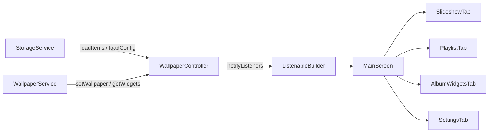

# 03 - State Management, Storage & Persistence

State management patterns, persistence layer, local file storage architecture, and the SharedPreferences contract between Flutter and Android native code.

---

## 1. State Management Architecture

Wall Tap uses the standard Flutter `ChangeNotifier` pattern via `WallpaperController`.



### 1.1 Dependency Injection & Test Isolation
`WallpaperController` accepts optional service implementations in its constructor:

```dart
WallpaperController({
  StorageService? storageService,
  WallpaperService? wallpaperService,
})  : _storageService = storageService ?? StorageService(),
      _wallpaperService = wallpaperService ?? WallpaperService();
```

This constructor allows unit and widget tests to inject fakes (`FakeStorageService`, `FakeWallpaperService`) without invoking real platform channels or disk I/O.

### 1.2 Encapsulation & Read-Only Views
Internal mutable lists remain private. The controller exposes unmodifiable views to prevent unintended state mutation from widgets:

```dart
List<WallpaperItem> get items => List.unmodifiable(_items);
List<Album> get albums => List.unmodifiable(_albums);
List<AlbumWidgetConfig> get albumWidgets => List.unmodifiable(_albumWidgets);
```

### 1.3 Active Items & Album Filtering
The `activeItems` getter computes the active rotation list:
1. When an album is active (`activeAlbumId != null`), only wallpapers whose IDs exist in the album's `wallpaperIds` list and have `isEnabled == true` are returned.
2. When no album is selected, all items in the library with `isEnabled == true` are returned.

---

## 2. App Lifecycle & State Synchronization

Because launcher widgets and background alarms modify rotation indexes outside the Flutter runtime, the app synchronizes state on resume:

```dart
class _MainScreenState extends State<MainScreen> with WidgetsBindingObserver {
  @override
  void initState() {
    super.initState();
    WidgetsBinding.instance.addObserver(this);
    widget.controller.loadAlbumWidgets();
  }

  @override
  void didChangeAppLifecycleState(AppLifecycleState state) {
    if (state == AppLifecycleState.resumed) {
      widget.controller.reloadFromStorage();
      widget.controller.loadAlbumWidgets();
    }
  }
}
```

When `reloadFromStorage()` runs:
1. Re-reads config and indices from `SharedPreferences`.
2. Compares active index, interval, screen target, and battery optimization state against memory.
3. If native routines advanced the wallpaper or changed settings, the controller updates internal fields and calls `notifyListeners()`.

---

## 3. SharedPreferences Key Registry

Android native code (`Context.getSharedPreferences("FlutterSharedPreferences", MODE_PRIVATE)`) and Flutter (`package:shared_preferences`) share the same XML backing file. In Flutter's Android implementation, all keys are saved with a `"flutter."` prefix.

> [!CAUTION]
> Never rename or remove keys below without updating both Dart (`StorageService.dart`) and Kotlin (`MainActivity.kt`, `WidgetProvider.kt`, `AlbumWidgetProvider.kt`, `AlarmReceiver.kt`).

| Key Name | Dart Key Constant | Type | Read/Written By | Purpose |
| :--- | :--- | :--- | :--- | :--- |
| `flutter.walltap_items` | `_keyItems` | String (JSON) | Dart | Serialized list of all `WallpaperItem` records. |
| `flutter.walltap_config` | `_keyConfig` | String (JSON) | Dart & Kotlin | Serialized `SlideshowConfig` containing app rotation settings. |
| `flutter.walltap_playlist_paths` | `_keyPaths` | String (JSON) | Dart & Kotlin | JSON array of file paths for active rotation items. Read directly by Kotlin `WidgetProvider`. |
| `flutter.walltap_current_index` | `_keyCurrentIndex` | Long / Int | Dart & Kotlin | Index of the currently set wallpaper in the active playlist. |
| `flutter.walltap_next_index` | `_keyNextIndex` | Long / Int | Dart & Kotlin | Index of the upcoming wallpaper displayed on widget preview. |
| `flutter.walltap_target_screen` | `_keyTargetScreen` | String | Dart & Kotlin | Screen target (`"both"`, `"home"`, or `"lock"`). |
| `flutter.walltap_scale_type` | `_keyScaleType` | String | Dart & Kotlin | Scaling mode (`"full"`, `"crop"`, or `"fit"`). |
| `flutter.walltap_is_random` | `_keyIsRandom` | Boolean | Dart & Kotlin | Whether rotation order is randomized. |
| `flutter.walltap_slideshow_enabled`| `_keySlideshowEnabled` | Boolean | Dart & Kotlin | Master toggle for automated rotation timer. |
| `flutter.walltap_interval_minutes` | `_keyIntervalMinutes` | Long / Int | Dart & Kotlin | Interval in minutes between rotations (0 = manual). |
| `flutter.walltap_albums` | `_keyAlbums` | String (JSON) | Dart & Kotlin | Serialized list of `Album` objects. Read by native `AlbumWidgetProvider`. |
| `flutter.walltap_active_album_id` | `_keyActiveAlbumId` | String | Dart | ID of album currently powering Studio rotation (or null for all). |
| `flutter.walltap_current_wallpaper_id` | `_keyCurrentWallpaperId` | String | Dart | ID of active device wallpaper (used to render `CURRENT` badge). |
| `flutter.album_widget_${id}_album_id` | N/A | String | Dart & Kotlin | Target album ID for home screen widget instance `${id}`. |
| `flutter.album_widget_${id}_album_name` | N/A | String | Dart & Kotlin | Display name of album for home screen widget `${id}`. |
| `flutter.album_widget_${id}_interval_minutes` | N/A | Long / Int | Dart & Kotlin | Auto-advance interval for home screen widget `${id}`. |
| `flutter.album_widget_${id}_is_random` | N/A | Boolean | Dart & Kotlin | Random vs sequential order for home screen widget `${id}`. |
| `flutter.album_widget_${id}_current_index` | N/A | Long / Int | Dart & Kotlin | Current photo index displayed in home screen widget `${id}`. |
| `flutter.album_widget_${id}_show_controls` | N/A | Boolean | Kotlin | Whether on-screen controls are visible on the widget. |

---

## 4. Local File Storage

Wallpapers imported into Wall Tap are copied into internal application storage to maintain accessibility if original files on external storage are moved or deleted.

### 4.1 Storage Location
```
<app_internal_storage>/app_flutter/wallpapers/
```
Accessed through `path_provider.getApplicationDocumentsDirectory()`.

### 4.2 File Naming Format
Files are named with timestamp and sanitized filename:
```
wall_${timestamp}_${sanitizedFileName}.${extension}
```
Example: `wall_1716301294821_cyberpunk_neon_city.jpg`

Characters outside alphanumeric, underscore, and dot are replaced with `_`.

### 4.3 Dimension Extraction
When an image is imported, `StorageService.getImageDimensions` reads pixel dimensions without decoding full uncompressed pixel arrays, using Flutter's low-level codec:

```dart
final codec = await ui.instantiateImageCodec(bytes);
final frameInfo = await codec.getNextFrame();
final width = frameInfo.image.width;
final height = frameInfo.image.height;
```

---

## 5. Deletion & Cleanup Cascade

When wallpapers are deleted through `controller.deleteItems(ids)`:
1. Items are removed from `_items`.
2. Corresponding files are deleted from storage:
   ```dart
   await _storageService.deleteWallpaperFile(item.path);
   ```
3. All albums are scanned, and deleted IDs are removed from their `wallpaperIds` lists.
4. If the active device wallpaper was deleted, `_currentWallpaperId` resets to null.
5. If `currentIndex` exceeds the updated active playlist length, it is clamped to `active.length - 1`.
6. Active playlist paths are synced to native preferences via `_storageService.syncActivePlaylistPaths`.
7. `syncAllAlbumWidgets()` refreshes all home screen widgets so deleted images disappear from widgets immediately.
