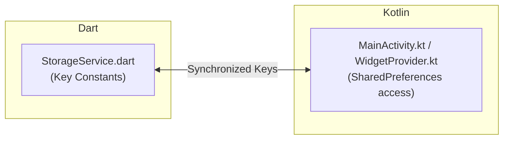

# 08 - AI Agent Development Guidelines & Guardrails

This document defines critical rules, architecture invariants, memory constraints, and quality standards for AI coding agents developing, refactoring, or extending Wall Tap.

---

## 1. Proactive Flutter Hot Reload Rule

Whenever modifying any `.dart` file under `lib/`:
1. **When to Skip**:
   - Files outside `lib/` (e.g., `test/**`, `docs/**`, `android/**`).
   - Changes that only affect comments, documentation, or whitespace.
2. **Discover & Connect**:
   - Discover active running application instances using the `dtd` tool (or Dart MCP server).
3. **Trigger Hot Reload / Hot Restart**:
   - Execute `hot_reload` immediately after making changes to UI widgets or simple methods.
   - Execute `hot_restart` if fundamental logic, state initialization (`initState`), global/static state, or `main()` was modified.
4. **App Not Running**:
   - If no app is running, proceed without blocking code edits.

---

## 2. Dual-Engine Contract Synchronization

Wall Tap is a hybrid application where Flutter and Kotlin share data across process boundaries:

### Invariant Rules
- **Prefix Rule**: Kotlin SharedPreferences keys use the `"flutter."` prefix (e.g., `"flutter.walltap_current_index"`).
- **Zero-Drift Policy**: Never rename or add a preference key in `StorageService.dart` without simultaneously updating:
  1. `android/app/src/main/kotlin/com/zavierdev/walltap/MainActivity.kt`
  2. `android/app/src/main/kotlin/com/zavierdev/walltap/WidgetProvider.kt`
  3. `android/app/src/main/kotlin/com/zavierdev/walltap/AlbumWidgetProvider.kt`
  4. `docs/03-state-management-and-storage.md`

---

## 3. Platform Channel Stability

The `MethodChannel` name is **`com.walltap.app/wallpaper`**.

- When adding a new platform method, declare it in `WallpaperService.dart`, handle it in `MainActivity.kt`'s `setMethodCallHandler`, update `docs/01-architecture.md`, and add a mock handler in `FakeWallpaperService` (`test/wallpaper_controller_test.dart`).
- Never change method names or expected argument types without updating all call sites.

---

## 4. Memory Safety & Bitmap Bounds

Wallpapers frequently exceed 4K/8K resolution (e.g., 3840x2160 or 7680x4320). Unconstrained loading causes fatal `OutOfMemoryError` crashes on Android.

### Rules for Image Handling
1. **Dart UI Code**:
   - Use `Image.file(..., cacheWidth: ..., cacheHeight: ...)` or standard thumbnail constraints when rendering gallery grids.
   - For metadata extraction, use `StorageService.getImageDimensions` which uses `instantiateImageCodec` without allocating full raw pixel arrays.
2. **Kotlin Native Code**:
   - **Never** call `BitmapFactory.decodeFile()` without setting `inJustDecodeBounds = true` first to compute `inSampleSize`.
   - Use `Bitmap.Config.RGB_565` for widget thumbnails to halve memory usage compared to `ARGB_8888`.
   - Explicitly recycle temporary bitmaps (`scaledBitmap.recycle()`) once submitted to `WallpaperManager` or `RemoteViews`.

---

## 5. State Management & Lifecycle Invariants

1. **Unidirectional Data Flow**:
   - Views must never mutate `_items`, `_albums`, or `_config` directly.
   - All state mutations must route through `WallpaperController` methods which handle persistence and call `notifyListeners()`.
2. **App Lifecycle Observer**:
   - Do not remove or bypass the `WidgetsBindingObserver` in `MainScreen`.
   - `controller.reloadFromStorage()` is essential for syncing background widget rotations into the active UI upon app resume.
3. **Deletion Cascades**:
   - When deleting a wallpaper, always use `controller.deleteItem(id)` or `controller.deleteItems(ids)` to guarantee that physical files, album references, active wallpaper IDs, playlist caches, and home screen widgets are updated in a single atomic sequence.

---

## 6. UI & Design System Rules

1. **OLED Dark Palette**:
   - Scaffold background must remain `#0D0E12`.
   - Primary surface containers must use `#16181F` or `#161822`.
   - Primary brand accent must be `#FFFF3B30` (Crimson).
2. **Tactile Micro-Interactions**:
   - Wrap all interactive cards, buttons, and grid tiles in `PressableScale`.
   - Trigger appropriate haptic feedback (`selectionClick` for toggles, `mediumImpact` for CTAs and mode switches).
3. **Status Badge Rule**:
   - `CURRENT` badge (Crimson): Only render when image matches active device wallpaper.
   - `EXCLUDED` badge (Slate): Only render when item is disabled from rotation.
   - Active items must remain **clean and badge-free**.
4. **Bottom Nav Clearance**:
   - All scrollable views must include a bottom padding of at least `100pt` to `120pt` to avoid occlusion by the floating glass bar.

---

## 7. Automated Test Discipline

- **Run Tests Before Finishing**: Every AI agent turn that modifies business logic or UI must run `flutter test` to ensure all 60+ tests pass.
- **Add Tests for New Features**: When adding controller methods or UI behaviors, write corresponding tests in `test/` using `FakeStorageService` and `FakeWallpaperService`.
- **Static Analysis**: Verify `dart analyze` reports zero errors and zero warnings.
